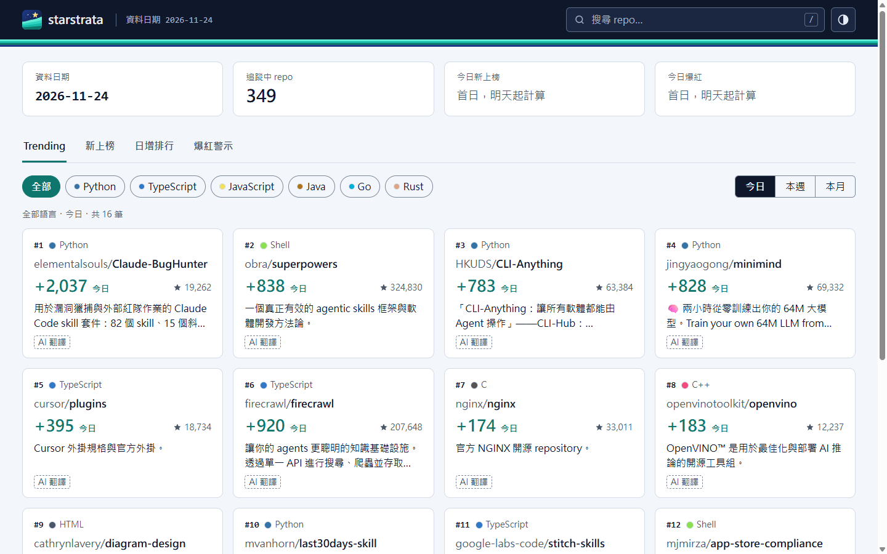

<p align="center">
  
</p>

<h1 align="center">starstrata</h1>

<p align="center"><a href="README.md">English</a> | 繁體中文</p>

<p align="center">
  <a href="https://github.com/xjin9612/starstrata/actions/workflows/ci.yml"></a>
  <a href="LICENSE"></a>
</p>

starstrata 每天收集 GitHub 趨勢，累積成長期歷史，讓你看出什麼在上升、什麼是新冒出來的、哪些 repo 突然爆紅。

**線上 dashboard：<https://xjin9612.github.io/starstrata/>**

- 每日快照：GitHub Trending（總榜加六種語言；今日、本週、本月）、Search API 找到的新建 repo，以及所有追蹤中 repo 的 star 數。
- dashboard：Trending 卡片（名次變化、7 日走勢線、依新增 star 排序）、新上榜、日增排行、爆紅警示、週報與月報，以及每個 repo 的 star 歷史與作者短評。介面、Telegram 訊息與報告可選繁體中文或英文。
- Telegram 每日摘要與爆紅警示；週報、月報附 AI 解讀。
- repo 說明翻成 `translation.target` 設定的語言（本 repo 為繁體中文）。全部在 GitHub Actions 上執行，不需要伺服器或資料庫主機。



## 開始前須知

- **費用**：公開 repo 使用 GitHub 提供的標準 runner 免費（[GitHub Actions 計費](https://docs.github.com/en/billing/concepts/product-billing/github-actions)）。fork 後請保持公開。
- **API 額度**：`GH_PAT` 與你帳號的其他 personal access token 共用每小時 5,000 次的額度（[額度說明](https://docs.github.com/en/rest/using-the-rest-api/rate-limits-for-the-rest-api)）。每次執行最多用掉約 1,000 次 REST 請求，由 `backfill.daily_request_budget` 決定，另外加上少量 GraphQL 與 Search 請求。
- **Gemini 免費方案**：Google 會用免費服務收到的內容改進產品，也可能經人工審閱（[Gemini API 條款](https://aistudio.google.com/docs/terms)）。starstrata 只送出公開 repo 的說明與 README。

## 部署自己的版本

1. fork 這個 repo，保持公開。Actions 頁面要求啟用 workflow 時，選擇啟用。
2. 在 `config.toml` 把 `notify.site_url` 改成 `https://<你的帳號>.github.io/<repo>/`；設為 `""` 則 Telegram 不附 dashboard 按鈕，網頁的分享預覽標籤也不帶網址與圖片。頁尾的 GitHub 專案連結會自動帶入。
   把 `translation.target` 設成 repo 說明要翻成的語言（例如 `ja`）；設為 `""` 則不翻譯。把 `i18n.locale` 改成 `en`，dashboard、Telegram 訊息與報告都會改用英文。
   清空 `notes.toml`：裡面的短評是原作者的個人內容。
3. 在 Settings → Secrets and variables → Actions 建立 secrets：

   | 名稱 | 必要 | 用途 |
   |---|---|---|
   | `GH_PAT` | 是 | fine-grained personal access token，不需授予任何權限；預設就能讀取公開 repo（[說明](https://docs.github.com/en/authentication/keeping-your-account-and-data-secure/managing-your-personal-access-tokens)） |
   | `TELEGRAM_BOT_TOKEN` | 否 | Telegram bot token；未設定時不發送訊息 |
   | `TELEGRAM_CHAT_ID` | 否 | 接收訊息的對話；見 [Telegram](#telegram) |
   | `GEMINI_API_KEY` | 否 | 說明翻譯與報告解讀（預設供應商），在 [Google AI Studio](https://aistudio.google.com) 免費建立。未設定時顯示原文，報告不含解讀 |
   | `ANTHROPIC_API_KEY` | 否 | `reports.provider` 設為 `anthropic` 時改用 Claude |

   要發到群組的某個主題時，另外在同一頁的 Variables 分頁建立 repository variable `TELEGRAM_THREAD_ID`，見 [Telegram](#telegram)。它是 variable 而不是 secret：GitHub 會把 secret 的值從 log 遮掉，`3` 這種短數字會讓 log 裡相同的數字都被遮掉。

4. 在 Settings → Pages → Build and deployment，把 Source 設為 **GitHub Actions**。
5. 第一次收集：在 Actions → `Daily` → Run workflow 手動執行，或執行 `gh workflow run daily.yml -R <owner>/<repo>`。

之後 `Daily` workflow 每天 UTC 21:17（`Asia/Taipei` 05:17）執行；GitHub 負載高時會延後排程。每次執行會：

- 把當天快照 commit 到 `data/`，報告 commit 到 `reports/`；
- 把 SQLite 上傳到 tag 為 `db` 的 Release；
- 發送 Telegram 摘要與警示；
- 部署 dashboard 到 GitHub Pages。

第一天只建立基準，新上榜、日增排行與爆紅警示從第二天開始出現。

## Telegram

1. 用 [@BotFather](https://t.me/BotFather) 建立 bot，複製 token。
2. 把 bot 加進群組，在群組裡傳 `/start@<bot 帳號>`。bot 預設開啟 privacy mode，在群組裡只收得到指名給它的指令（[privacy mode](https://core.telegram.org/bots/features#privacy-mode)）。
3. 查出 chat ID：在回應中找 `chat.type` 為 `group` 或 `supergroup` 的訊息，使用它的 `chat.id`。

   ```sh
   curl -s "https://api.telegram.org/bot<token>/getUpdates"
   ```

4. 把 `TELEGRAM_BOT_TOKEN` 與 `TELEGRAM_CHAT_ID` 存成 secrets。

要把訊息發到開啟 Topics 的群組裡的某個主題：

1. 在群組設定開啟 Topics。有主題的群組是超級群組（[`is_forum`](https://core.telegram.org/bots/api#chat)），一般群組會升級為超級群組，chat ID 跟著改變，要更新 `TELEGRAM_CHAT_ID`。
2. 在目標主題裡傳 `/start@<bot 帳號>`。
3. 在上面 `getUpdates` 的回應中，這則訊息的 `message.message_thread_id` 就是主題 ID，存成 repository variable `TELEGRAM_THREAD_ID`。

沒有設定 `TELEGRAM_THREAD_ID` 或設為 `1` 時，訊息發到 General。值不是正整數時，`notify` 不發送任何訊息，結束碼為 `2`。

每日摘要靜音發送；爆紅警示會發出通知音，並附 GitHub 與 dashboard 按鈕。群組之後升級為超級群組時 chat ID 會改變（[`migrate_to_chat_id`](https://core.telegram.org/bots/api#message)），要更新 `TELEGRAM_CHAT_ID`。

## 設定

所有設定都在 `config.toml`，每個鍵都有註解。未知的鍵或超出範圍的值會讓執行停止，結束碼 `2`。

| 區段 | 控制 |
|---|---|
| `[schedule]` | 判定快照日期的時區 |
| `[trending]` | Trending 的語言與期間 |
| `[search]` | 收集哪些新建的 repo |
| `[tracking]` | repo 何時轉為休眠或恢復追蹤 |
| `[alerts]` | 爆紅門檻與冷卻期 |
| `[backfill]` | 每次執行用於回補 star 歷史的 API 請求數 |
| `[notify]` | Telegram 摘要的長度與 dashboard 網址 |
| `[reports]` | AI 供應商、模型、備用模型與解讀的專案數 |
| `[i18n]` | dashboard、Telegram 訊息與報告的語言：`zh-TW` 或 `en` |
| `[translation]` | 說明翻譯的目標語言（`target`，空字串表示不翻譯）、每批則數、每次上限與請求間隔 |

執行時間寫在 `.github/workflows/daily.yml` 的 `cron`。

`notes.toml` 是選用的作者一句話短評，顯示在 repo 詳細頁與卡片上。格式不合時 `starstrata site` 停止，結束碼 `2`；格式見 [docs/DEVELOPMENT.md](docs/DEVELOPMENT.md)。

## 本機執行

照 [docs/DEVELOPMENT.md](docs/DEVELOPMENT.md) 建立開發環境，再執行：

```sh
GH_PAT=<token> .venv/bin/starstrata collect    # 抓取當天快照
.venv/bin/starstrata ingest                    # 把快照匯入 SQLite
GEMINI_API_KEY=<key> .venv/bin/starstrata translate
GH_PAT=<token> .venv/bin/starstrata backfill   # 回補 star 歷史
.venv/bin/starstrata report due                # 產生該產生的週報、月報
.venv/bin/starstrata site                      # 產生 dashboard 到 _site/
```

`notify` 發送 Telegram 訊息，需要 `TELEGRAM_BOT_TOKEN` 與 `TELEGRAM_CHAT_ID`；`TELEGRAM_THREAD_ID` 可不設定。`rebuild` 從全部快照重建 SQLite。

| 結束碼 | 意義 |
|---|---|
| `0` | 成功 |
| `1` | 部分失敗：資料來源失敗、API 額度用盡、報告解讀失敗或 Telegram 發送失敗；已取得的資料照常保存 |
| `2` | 設定錯誤或缺少必要的環境變數，沒有執行任何工作 |

`translate` 除了設定錯誤以外一律回傳 `0`，翻譯失敗只記警告。

## 疑難排解與已知限制

- **說明一直是英文**：Gemini 免費方案在尖峰時常回應 `503 UNAVAILABLE`。沒有譯文的說明顯示原文，每天執行時會再補翻；一再失敗的說明會排到最後。改了 `translation.target` 之後，新語言要從頭翻，每次執行最多翻 `translation.max_per_run` 則。
- **Trending 停止更新**：Trending 沒有官方 API，starstrata 解析網頁 HTML。GitHub 改版可能讓解析失效，直到程式更新；Search 與 repo 快照照常運作。
- **star 歷史比預期少**：star history API 只計入目前仍給 star 的使用者。回補每次有請求上限，老 repo 需要幾天才補齊。
- **repo 頁面顯示「找不到」**：repo 頁面使用目前的 `owner/name`，改名後舊連結會失效。
- **workflow 失敗**：有設定 Telegram 時，群組會收到附執行連結的失敗通知。失敗前已收集的快照照常 commit。
- 快照封存尚未實作。從 `data/` 刪除某一天，下次重建 DB 時該天的資料就會消失。

## 開發

設計、資料格式與測試見 [docs/DEVELOPMENT.md](docs/DEVELOPMENT.md)，需求規格見 [docs/REQUIREMENTS.md](docs/REQUIREMENTS.md)。

## 授權

[MIT](LICENSE)
