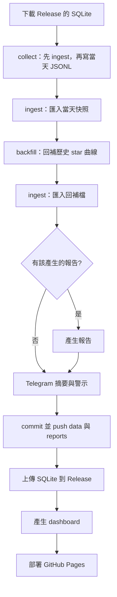

# starstrata 設計

需求見 [REQUIREMENTS](REQUIREMENTS.md)。本文件說明模組分工、資料格式與每日執行流程。

## 模組

| 模組 | 責任 |
|---|---|
| `config` | 讀取並驗證 `config.toml` |
| `github.http` | 共用 HTTP client、API 額度與重試處理 |
| `github.trending` | 抓取並解析 Trending HTML |
| `github.search` | 呼叫 Search API |
| `github.repos` | 用 GraphQL 批次查詢 repo 快照 |
| `github.star_history` | 呼叫 star history API |
| `collect` | 串起各資料來源，寫入當天快照 |
| `snapshots` | 快照的資料結構、路徑與 JSONL 讀寫 |
| `db` | SQLite schema 與連線 |
| `ingest` | 匯入快照與回補檔、判斷是否重建 |
| `tracking` | 追蹤狀態轉換與每日需要快照的 repo |
| `alerts` | 爆紅判定 |
| `backfill` | 在每日預算內回補歷史 star 曲線 |
| `queries` | dashboard 與通知共用的查詢 |
| `telegram` | 發送 Telegram 訊息 |
| `notify` | 每日摘要與爆紅警示 |
| `reports` | 週報、月報與 AI 中文解讀 |
| `gemini` | 呼叫 Gemini API 取得 JSON 回應 |
| `site` | 從 SQLite 產生 dashboard |
| `cli` | 命令列入口 |

dashboard 前端放在 `web/`，是純 HTML/JS/CSS，不經過建置。

## 每日執行流程

- DB 不存在或與快照不一致時，`ingest` 會從全部快照重建，詳見「SQLite」。
- 快照先 push，再上傳 SQLite。DB 裡的資料一定能在 git 找到對應快照。
- `ingest` 匯入所有「有快照但 DB 沒有」的日期，所以上次上傳失敗的日期會自動補上。
- 通知在 push 之前發送，讓發送紀錄 `notified.json` 跟快照一起 commit。
- 執行日期依 `schedule.timezone` 判定。
- 各步驟的失敗處理見「GitHub Actions」。

## 命令列

| 指令 | 作用 |
|---|---|
| `starstrata collect` | 抓取所有資料來源，寫入當天快照 |
| `starstrata ingest` | 把尚未匯入的快照寫進 SQLite，並更新追蹤狀態 |
| `starstrata rebuild` | 刪除 SQLite，從全部快照重建 |
| `starstrata notify` | 發送當天的 Telegram 摘要與警示 |
| `starstrata backfill` | 在每日預算內回補歷史 star 曲線，再匯入 SQLite |
| `starstrata report due\|weekly\|monthly` | 產生週報或月報 |
| `starstrata site` | 產生 dashboard JSON 到 `_site/` |

共用參數：`--config`（預設 `config.toml`）、`--data`（預設 `data`）、`--db`（預設 `starstrata.sqlite`）。

- `collect` 開始前先執行一次 `ingest`，讓追蹤池與 repo 狀態是最新的。匯入失敗時沿用既有 DB；DB 也無法讀取時只收集 Trending 與 Search，結束碼為 `1`。
- `collect` 與 `backfill` 需要環境變數 `GH_PAT`。

| 結束碼 | 意義 |
|---|---|
| `0` | 成功 |
| `1` | `collect` 有資料來源失敗或匯入失敗、`backfill` 遇到 API 額度用盡、`report` 的解讀失敗，或 `notify` 發送失敗；已取得的資料照常寫入 |
| `2` | 設定錯誤或缺少環境變數，沒有執行任何工作 |

## 快照格式

路徑：`data/YYYY/MM/DD/<source>.jsonl`，每行一個 JSON 物件，鍵依字母排序。

| 檔案 | 每行內容 |
|---|---|
| `trending.jsonl` | `period`、`language`（總榜為 `null`）、`rank`、`full_name`、`stars_in_period` |
| `search.jsonl` | `rank`、`node_id`、`full_name` |
| `repos.jsonl` | `node_id`、`full_name`、`stars`、`forks`、`watchers`、`open_issues`、選用的 `meta`；依 `node_id` 排序 |
| `run.json` | 執行時間、各資料來源的狀態與錯誤、查不到的 Trending repo、停止查詢與暫時查不到的 repo、API 剩餘額度 |
| `notified.json` | 已發送的每日摘要與警示，由 `notify` 寫入 |

`repos.jsonl` 的規則：

- `meta`：`description`、`topics`、`language`、`archived`、`created_at`。首次記錄或內容變動時才寫。
- GitHub 對 repo 回報 NOT_FOUND，或 node 本身的錯誤（例如 FORBIDDEN）時，該行只有 `node_id` 與 `status: "gone"`。NOT_FOUND 以外的原因記在 `run.json` 的 `unavailable_repos`。
- 暫時查不到的 repo（子欄位錯誤、沒有錯誤說明的 null、無法解析）不寫入 `repos.jsonl`，記在 `run.json` 的 `node_errors`，`repos` 來源狀態為 `partial`，下次照常查詢。
- `open_issues` 只計 issue，不含 pull request。

Trending 頁面只有 `full_name`。`collect` 在同一次執行中用 GraphQL 以名稱查出 `node_id`。
`trending.jsonl` 的 `full_name` 改寫成 GraphQL 回傳的正式名稱，與 `repos.jsonl` 完全一致。
`ingest` 用當天的 `repos.jsonl` 把 `full_name` 對應到 `node_id`，當天沒有時改查 DB（不分大小寫）。同名的 repo 有多個時，優先選不是 `gone`、最近有快照的。都查不到的 repo 列在 `run.json`，`ingest` 略過。

資料來源的狀態：

| 狀態 | 意義 | 檔案 |
|---|---|---|
| `ok` | 全部成功 | 寫入 |
| `partial` | 部分頁面或批次失敗 | 寫入取得的部分 |
| `failed` | 沒有取得任何資料 | 不寫，當天既有的檔案保持不變 |

Trending 頁面解析結果為 0 筆時，該頁視為失敗。Search 結果為 0 筆是正常結果。

同一天重跑時，新結果與當天既有的檔案合併：

- `trending.jsonl`：成功抓取的頁面取代該頁的舊資料，失敗的頁面保留舊資料。
- `repos.jsonl`：以 `node_id` 合併，這次沒查到的 repo 保留舊資料。既有的列帶有 `meta` 時，新列也帶 `meta`。
- `search.jsonl`：成功時整個取代，失敗時保留。

快照格式只能新增選用欄位。既有快照必須永遠能被 `ingest` 匯入。

### 回補資料

- 路徑：`data/backfill/<hex>.jsonl`，`<hex>` 是 `node_id` 的 UTF-8 十六進位編碼。`node_id` 區分大小寫，Windows 與 macOS 的檔案系統預設不區分，直接當檔名會互相覆蓋。
- 每行是一週：`week`（週日的 UTC 日期）與 `days`（週日起 7 天的新增 star 數）。
- 只寫新增 star 數大於 0 的週，由舊到新排列。沒有任何 star 的 repo 寫入空檔案，表示已回補。
- 以週為單位儲存，是為了控制 git 的增長；`ingest` 匯入時展開成每日資料。
- 一個 repo 全部頁面抓完才寫檔，不保存中途進度。
- 待回補清單是「不是 `gone`、尚未匯入回補檔、也沒有回補檔」的 repo，依首次出現日期排序。
- 所需請求數估計為 repo 建立至今的週數加 2，除以 30 再進位。估計值超過剩餘預算時，本次回補結束。
- 實際所需請求數超過剩餘預算時，捨棄該 repo 已抓的部分，本次回補結束。
- 單一 repo 回補失敗時記錄警告並跳過，下次執行再試。
- 翻頁期間跨入新的一週時，頁面內容往後位移一週，同一週會出現在兩頁；保留先抓到的那筆。
- API 只計入目前仍給 star 的使用者。各週加總等於當下的 star 數。
- `ingest` 依檔案雜湊同步回補資料：新增或改變的檔案重新匯入，刪除的檔案移除。回補資料不影響追蹤狀態與警示。

## SQLite

- Release tag：`db`，asset 名稱：`starstrata.sqlite.gz`。
- 下載與上傳用 workflow 內的 `gh release` 指令。
- DB 內容全部可由快照重建，不存任何快照以外的資料。

| 資料表 | 主鍵 | 內容 |
|---|---|---|
| `repos` | `node_id` | 最新 `full_name`、`meta`、追蹤狀態、首次出現日期 |
| `repo_daily` | `node_id`, `date` | 快照的數值欄位 |
| `trending_entries` | `date`, `period`, `language`, `rank` | Trending 上榜紀錄 |
| `search_hits` | `date`, `rank` | Search 結果 |
| `star_backfill` | `node_id`, `date` | 回補的每日新增 star 數 |
| `backfilled` | `node_id` | 已匯入的回補檔與其雜湊 |
| `alerts` | `node_id`, `date` | 爆紅警示與當時的基準值 |
| `ingested_dates` | `date` | 已匯入的快照日期與快照檔雜湊 |
| `meta` | `key` | `schema_version` 與推導設定的雜湊 |

`ingest` 遇到以下情況時捨棄 DB，從全部快照重建：

- DB 不存在或無法讀取
- DB 的 `schema_version` 與程式的 `SCHEMA_VERSION` 不符
- `[tracking]` 或 `[alerts]` 設定改變
- 已匯入日期的快照檔內容改變或被刪除
- 出現比已匯入日期更早的新快照日期

重建先寫到 `<db>.rebuild`，完成後才取代原檔。
修改 schema 或匯入邏輯時，必須遞增 `db.SCHEMA_VERSION`。

## 追蹤狀態

`ingest` 依日期順序處理快照。同一天內依序套用 `gone`、出現、降頻與恢復。同一天被標為 `gone` 的 repo，即使出現在 Trending 或 Search 也維持 `gone`：Search 與 GraphQL 的結果不一致時，以 GraphQL 為準。

| 轉換 | 條件 |
|---|---|
| 新增為 `active` | 當天出現在 Trending 或 Search |
| `dormant` → `active` | 當天出現在 Trending 或 Search |
| `dormant` → `active` | 與前一次快照相比，star 增加 ≥ `reactivate_weekly_stars` |
| `active` → `dormant` | 最近 `dormant_after_days` 筆快照都與前一天相鄰，且日增 star 都低於 `dormant_daily_stars_below` |
| 任何狀態 → `gone` | 快照的 `status` 為 `gone` |
| `gone` → `active` | 之後的日期再次出現在 Trending 或 Search |

`collect` 依狀態決定當天要查哪些 repo：

- `active`：每天查。
- `dormant`：距離上次快照達 `dormant_snapshot_interval_days` 天才查。
- `gone`：不查。

狀態完全由快照與設定推導。調整門檻後執行 `rebuild`，狀態會依新門檻重算。
已經沒有每日快照的歷史期間，重算後也不會補出資料。

## 爆紅判定

- 日增 star：當天快照與前一天快照的 star 差。前一天沒有快照時不判定。
- 基準：前 `baseline_days` 天內、前後兩天都有快照的日增 star 平均。
- 基準資料不足 `baseline_days` 筆時，只檢查 `min_daily_stars`。
- 門檻判斷都含等號：日增 star ≥ `min_daily_stars`，且 ≥ `multiplier` × 基準。
- 同一 repo 的兩次警示至少相隔 `cooldown_days` 天；`0` 表示不設冷卻。
- 警示在 `ingest` 時判定並寫入 `alerts`，重建時會重新判定。

## API 使用

| 用途 | 端點 | token |
|---|---|---|
| Trending | `https://github.com/trending` HTML | 不需要 |
| Search | REST `GET /search/repositories` | `GH_PAT` |
| repo 快照 | GraphQL，一次 100 個 node | `GH_PAT` |
| 回補 | REST `GET /repos/{owner}/{repo}/stargazers/history`，每頁最多 30 週 | `GH_PAT` |

- REST 請求固定帶 `X-GitHub-Api-Version: 2026-03-10`。
- API 請求固定帶 `X-Github-Next-Global-ID: 1`。沒有這個 header 時，舊 repo 會回傳舊格式的 node ID。GraphQL 的行為見[官方說明](https://docs.github.com/en/graphql/guides/migrating-graphql-global-node-ids)；Search API 的 `node_id` 同樣受這個 header 影響，官方文件沒有寫，是實測結果。
- 連續抓 Trending 頁面之間間隔 1 秒。
- token 只送到 `api.github.com`，抓 Trending 頁面不帶 token。
- 收到額度用盡的回應時，停止該資料來源，已取得的資料照常寫入。
- 5xx 與連線錯誤重試 3 次，間隔指數增加。
- Trending 連續 3 頁失敗時停止抓取。GraphQL 每一批獨立處理：一批失敗時記錄錯誤，繼續查下一批；連續 3 批失敗時停止查詢。只影響單一 repo 的錯誤不影響同批其他 repo。
- Trending 與 Search 抓完就先寫檔，查完 repo 後再以正式名稱改寫 `trending.jsonl`；查 repo 時被中斷，當天的 Trending 與 Search 仍會保留。
- 任何例外都只讓所屬的 Trending 頁面或資料來源失敗，其他來源照常寫入。
- Search API 只提供前 1000 筆，翻頁不超過第 1000 筆。
- 測試不連網路，HTTP 一律用 `httpx.MockTransport` 模擬。

## Dashboard

`starstrata site` 清空輸出目錄，複製 `web/` 與 icon，再從 SQLite 產生 JSON：

| 檔案 | 內容 |
|---|---|
| `data/latest.json` | 最新資料日期的 Trending 各頁、新上榜、日增前 50 名、最近 30 天的警示 |
| `data/index.json` | 所有 repo 的 `[node_id, full_name, language, state, stars]`，供搜尋使用 |
| `data/repos/<hex>.json` | 單一 repo 的 meta、star 累計點、每日新增 star、Trending 上榜紀錄；`<hex>` 與回補檔相同 |

- 產生 repo 檔時依 `node_id` 排序逐一讀取，記憶體用量不隨資料量增長。
- star 累計點：第一筆快照之前用回補資料累加，之後用快照。每個點標記來源，`b` 為回補、`s` 為快照。
- 每日新增 star：回補期間用回補資料；快照期間只在前一天也有快照時計算。
- 前端是 `web/` 的純 HTML/JS/CSS，不經過建置。資料一律用 `textContent` 放進 DOM。
- 圖表：star 數用折線，每日新增用長條，各自一個 y 軸。單一數列不加圖例。滑鼠與方向鍵可逐點查看數值，另有資料表。
- 配色依 dataviz 參考色盤，淺色與深色模式各自驗證過。

部署由 `daily.yml` 的 `deploy` job 執行。`daily` job 因收集失敗而標為失敗時，dashboard 仍照常部署。

## 定期報告

`starstrata report due` 每天檢查最近一個完整的週（週一到週日）與月：

- 報告不存在時產生。
- 標示缺漏的報告只在期間結束後 3 天內重新產生，之後保留缺漏，避免持續失敗時每天重試。重新產生的解讀數比既有報告少時，保留既有報告。
- 期間內沒有任何已匯入的快照時不產生。
- 所以排程漏跑的週一或 1 日，之後的執行會自動補上。

報告：

- 路徑：`reports/weekly/YYYY-Www.md`（ISO 週）、`reports/monthly/YYYY-MM.md`。
- 期間內 star 增加量：期間內最後一筆快照，減去期間開始前 `tracking.dormant_snapshot_interval_days` 天內最後一筆快照。這段時間沒有快照時，改用期間內第一筆，避免把期間外的增加量算進來。
- 內容：本期有快照的 repo 數、star 增加最多的 20 個 repo、重點專案解讀、新上榜、爆紅警示。
- 數字只用期間內的資料（新上榜的 star 數取期間結束前最後一筆快照），期間結束後重新產生時數字不變；repo 名稱、語言與解讀取自產生當下。
- `report weekly|monthly --date <日期>` 重新產生指定日期之前最近一期的報告，覆寫既有檔案。

重點專案解讀：

- 增加量前 `reports.llm_top_n` 名，一次請求送給 `reports.provider` 指定的模型，以 JSON schema 限定輸出，取回每個 repo 的「在做什麼」與「為什麼受關注」。
- 提供給模型的資料：名稱、語言、topics、star 數、描述、README 前 4000 字元。README 用 `GH_PAT` 抓取，抓取失敗時略過該 repo 的 README。
- repo 描述與 README 放在 `<repo>` 標籤內，內容中的 `<repo>`、`</repo>` 先替換掉。system prompt 指示模型把標籤內容當資料，不當指示。
- 只採用輸入名單內的 `full_name`，其他回傳內容丟棄。
- 解讀寫進報告前當純文字處理：移除網址與 email，跳脫 Markdown 符號（含 `<`、`>`，HTML 只會顯示成文字）。

供應商：

| `reports.provider` | API key | 呼叫方式 |
|---|---|---|
| `gemini`（預設） | `GEMINI_API_KEY` | REST `generateContent`，`generationConfig.responseMimeType` 為 `application/json`，`responseJsonSchema` 限定格式。API key 放在 `x-goog-api-key` header。429 與 5xx 重試 2 次，間隔 5、10 秒 |
| `anthropic` | `ANTHROPIC_API_KEY` | Anthropic SDK，`output_config.format` 限定格式；帶 `fallbacks: "default"`（beta `server-side-fallback-2026-07-01`），模型拒答時由伺服器改用 Anthropic 建議的備援模型 |

- Gemini 回應的 `thought` part 是思考摘要，不採用。`finishReason` 不是 `STOP`、或 prompt 被擋下時視為失敗。
- Gemini 免費方案送出的內容會被 Google 用來改進產品，也可能經人工審閱（[條款](https://aistudio.google.com/docs/terms)）。送出的只有公開 repo 的資料。
- `reports.model` 只能包含小寫英數字、點與連字號，因為 Gemini 的模型名稱會放進網址路徑。

未設定所選供應商的 API key 時，解讀段落寫 `> 未產生解讀：` 開頭的說明，報告視為完整，結束碼 `0`。

解讀缺漏時，解讀段落以 `> 解讀缺漏：` 開頭的一行說明原因，`report due` 只比對這個行首：

| 情況 | 結束碼 |
|---|---|
| API 錯誤、拒答、輸出截斷或格式不符 | `1` |
| 模型只回傳部分 repo 的解讀 | `1` |

## Telegram

- 用 Bot API `sendMessage`，`parse_mode` 為 `HTML`，關閉連結預覽。
- 訊息中的 repo 名稱與描述都要做 HTML 跳脫。
- 單則訊息超過 4096 字元時依行分段發送。
- 每則訊息最多嘗試 3 次：連線錯誤與 5xx 間隔 1、2 秒重試；429 且 `retry_after` 不超過 60 秒時等待後重試。
- `sendMessage` 不是冪等操作：Telegram 已收下但回應失敗時，重試會重複發送。
- bot token 在請求網址裡。httpx 的 log 等級設為 WARNING，例外訊息也不帶網址。

每日摘要的內容：

- 新上榜：`first_seen` 為當天的 repo，依 star 數排序，最多 `notify.new_repos_limit` 個。
- 日增 star 前 `notify.top_gainers` 名：與前一天快照相比。
- 爆紅警示數量；每則警示另發一則訊息。
- 當天沒有匯入任何快照時，摘要改為提醒檢查 workflow。

已發送的項目記在當天快照目錄的 `notified.json`。同一天重跑時，已發送的摘要與警示不再發送。
當天尚未匯入快照時發出的提醒不記錄，補上快照後重跑會發送正式摘要。
未設定 `TELEGRAM_BOT_TOKEN` 或 `TELEGRAM_CHAT_ID` 時，`notify` 略過發送並回傳 `0`。

## GitHub Actions

| workflow | 觸發 | 內容 |
|---|---|---|
| `ci.yml` | push 到 `main`、pull request | ruff、mypy、pytest |
| `daily.yml` | `cron`、`workflow_dispatch` | 每日執行流程 |

`daily.yml`：

- 只在 `main` 執行；從其他分支手動執行時整個 job 略過，資料與 DB release 只屬於 `main`。
- checkout 取分支最新的 commit，重跑或排隊的執行也看得到先前已 push 的當天資料。
- 以 `PYTHONPATH=src` 執行 `python -m starstrata`，不建置套件；安裝的相依套件都經過 hash 驗證。
- 設定 `concurrency`，同時只允許一個執行，後到的排隊等待。
- 下載的 DB 解壓失敗時刪除，由 `ingest` 從快照重建。

各步驟失敗時的處理：

| 步驟 | 失敗時 |
|---|---|
| `collect`、`backfill`、`report`、`notify` | 後續步驟照常執行，job 最後標為失敗 |
| `ingest` | 略過 `backfill`、`report`、`notify`、上傳 DB 與 dashboard；照常 push 快照 |
| push | 重試 3 次；仍失敗時不上傳 DB |

- push 步驟以 `always()` 執行，任何步驟失敗或 job 被取消後都會嘗試保住當天已收集的快照。
- `collect`、`backfill`、`report` 設有步驟逾時。官方文件沒有說明步驟逾時是否套用 `continue-on-error`，尚未查證。
- job 失敗、逾時或被取消時，發送 Telegram 失敗通知。
- `deploy` job 在 dashboard 產生並上傳後執行，`daily` job 標為失敗也照常部署。

其他：

- 第三方 action 一律固定到 commit SHA。
- runner 固定為 `ubuntu-26.04`，不用 `ubuntu-latest`。
- Dependabot 每週檢查 pip 套件與 GitHub Actions 的更新（`.github/dependabot.yml`）。官方文件說明支援 `.txt` 與 PEP 621 的 `pyproject.toml`；能否依 `pyproject.toml` 重新產生含雜湊的 `requirements.txt`，文件沒有說明，尚未驗證。
- `GITHUB_TOKEN` 權限：`daily` job 為 `contents: write`，`deploy` job 為 `pages: write`、`id-token: write`。
