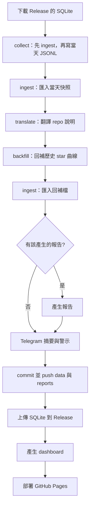

# 開發說明

本文件說明開發環境、模組分工、資料格式與每日執行流程。使用方式見 [README](../README.zh-TW.md)，需求規格見 [REQUIREMENTS](REQUIREMENTS.md)。

## 開發環境

需要 Python 3.14 以上，以及 Node.js（CI 使用 24 版）。`tests/test_calc.py` 用 `node` 執行前端的計算函式，不需要 npm 套件。

```sh
python3 -m venv .venv
.venv/bin/python -m pip install --require-hashes -r requirements-dev.txt
.venv/bin/python -m pip install --no-deps -e .
```

提交前四項檢查都要通過，與 CI 相同：

```sh
.venv/bin/ruff check .
.venv/bin/ruff format --check .
.venv/bin/mypy
.venv/bin/pytest
```

改了 `web/` 或 `site.py` 時，另外跑瀏覽器測試。第一次執行前先下載 Chromium：

```sh
.venv/bin/playwright install chromium
.venv/bin/pytest -m e2e
```

README 的截圖 `docs/screenshots/trending.png` 由 `scripts/screenshot.py` 產生：用 `data/` 建置網站，瀏覽器時鐘固定在收集完成後 2 小時再截圖。需要先下載 Chromium。

```sh
.venv/bin/python scripts/screenshot.py
```

預覽 dashboard：先執行 `.venv/bin/starstrata site`，再執行 `python3 -m http.server -d _site 8000`，開啟 `http://localhost:8000`。

## 相依套件

- 直接相依寫在 `pyproject.toml`；`requirements*.txt` 由它產生，不手動編輯。
- 修改後重新產生兩個檔案，指令寫在各檔案開頭。`pip-compile` 需要先在 `.venv` 安裝 `pip-tools`。
- Dependabot 每週檢查 pip 套件與 GitHub Actions 的更新，見「GitHub Actions」。

## 資料規則

- JSONL 快照是唯一的資料來源。SQLite 必須能從快照完整重建。
- 修改 DB schema 或匯入邏輯時，遞增 `db.SCHEMA_VERSION`，讓既有 DB 自動重建。
- 增量匯入與完整重建的結果必須相同，`tests/test_ingest.py` 有對照測試。
- 快照格式只能新增選用欄位。舊快照必須永遠能匯入。
- 各版快照格式的測試資料在 `tests/fixtures/snapshots/<版本>/`，提交後不再修改；格式改變時新增版本目錄，並加進 `tests/test_snapshot_formats.py`。譯文檔的測試資料在 `tests/fixtures/translations/<版本>/`，規則相同。
- 日期一律依 `config.toml` 的 `schedule.timezone` 判定，不直接用系統時區。

## 測試規則

- 測試不連網路。HTTP 用 `httpx.MockTransport` 模擬。
- Trending 解析的測試用存下來的真實 HTML，放在 `tests/fixtures/`。
- 每個門檻判斷都要有邊界值測試。
- 瀏覽器測試放在 `tests/e2e/`，標記為 `e2e`，預設的 `pytest` 不執行。
  - 流程：用 `tests/snapshot_builder.py` 寫 fixture 快照，執行 `starstrata site`，在本機起 HTTP server，再用 Playwright 開啟。
  - 每個測試結束時檢查：沒有 JS 錯誤、沒有失敗的請求、沒有連到本機以外的網址。預期會 404 的測試要自己檢查並清空 `failed_requests`。
  - 用 Playwright 的等待條件，不用固定秒數的等待。
- token 只從環境變數讀取：`GH_PAT`、`TELEGRAM_BOT_TOKEN`、`TELEGRAM_CHAT_ID`、`GEMINI_API_KEY`、`ANTHROPIC_API_KEY`。錯誤訊息與 log 不得輸出 token。
- `TELEGRAM_THREAD_ID` 也從環境變數讀取，在 workflow 裡取自 repository variable。它不是祕密，可以寫進 log；存成 secret 時，GitHub 會把 log 裡相同的數字都遮掉。

## 模組

| 模組 | 責任 |
|---|---|
| `config` | 讀取並驗證 `config.toml` |
| `github.http` | 共用 HTTP client、API 額度與重試處理 |
| `github.trending` | 抓取並解析 Trending HTML |
| `github.search` | 呼叫 Search API |
| `github.repos` | 用 GraphQL 批次查詢 repo 快照 |
| `github.star_history` | 呼叫 star history API |
| `collect` | 串起各資料來源，寫入當天快照 |
| `snapshots` | 快照的資料結構、路徑與 JSONL 讀寫 |
| `db` | SQLite schema 與連線 |
| `ingest` | 匯入快照與回補檔、判斷是否重建 |
| `tracking` | 追蹤狀態轉換與每日需要快照的 repo |
| `alerts` | 爆紅判定 |
| `backfill` | 在每日預算內回補歷史 star 曲線 |
| `queries` | dashboard 與通知共用的查詢 |
| `telegram` | 發送 Telegram 訊息 |
| `notify` | 每日摘要與爆紅警示 |
| `reports` | 週報、月報與 AI 解讀 |
| `gemini` | 呼叫 Gemini API 取得 JSON 回應 |
| `translate` | 把 repo 說明翻成 `translation.target` 的語言 |
| `site` | 從 SQLite 產生 dashboard |
| `report_html` | 把報告 Markdown 轉成 dashboard 用的 HTML |
| `notes` | 讀取並驗證作者短評 `notes.toml` |
| `site_page` | 產生網站時填入 `index.html` 的語言、說明、分享標籤與 GitHub 連結 |
| `cli` | 命令列入口 |

dashboard 前端放在 `web/`，是純 HTML/JS/CSS，不經過建置。

## 每日執行流程



- DB 不存在或與快照不一致時，`ingest` 會從全部快照重建，詳見「SQLite」。
- 快照先 push，再上傳 SQLite。DB 裡的資料一定能在 git 找到對應快照。
- `ingest` 匯入所有「有快照但 DB 沒有」的日期，所以上次上傳失敗的日期會自動補上。
- 通知在 push 之前發送，讓發送紀錄 `notified.json` 跟快照一起 commit。
- 執行日期依 `schedule.timezone` 判定。
- 各步驟的失敗處理見「GitHub Actions」。

## 命令列

| 指令 | 作用 |
|---|---|
| `starstrata collect` | 抓取所有資料來源，寫入當天快照 |
| `starstrata ingest` | 把尚未匯入的快照寫進 SQLite，並更新追蹤狀態 |
| `starstrata rebuild` | 刪除 SQLite，從全部快照重建 |
| `starstrata notify` | 發送當天的 Telegram 摘要與警示 |
| `starstrata backfill` | 在每日預算內回補歷史 star 曲線，再匯入 SQLite |
| `starstrata report due\|weekly\|monthly` | 產生週報或月報 |
| `starstrata site` | 產生 dashboard JSON 到 `_site/` |
| `starstrata translate` | 翻譯還沒有譯文的 repo 說明 |

共用參數：`--config`（預設 `config.toml`）、`--data`（預設 `data`）、`--db`（預設 `starstrata.sqlite`）。

- `collect` 開始前先執行一次 `ingest`，讓追蹤池與 repo 狀態是最新的。匯入失敗時沿用既有 DB；DB 也無法讀取時只收集 Trending 與 Search，結束碼為 `1`。
- `collect` 與 `backfill` 需要環境變數 `GH_PAT`。

| 結束碼 | 意義 |
|---|---|
| `0` | 成功 |
| `1` | `collect` 有資料來源失敗或匯入失敗、`backfill` 遇到 API 額度用盡、`report` 的解讀失敗，或 `notify` 發送失敗；已取得的資料照常寫入 |
| `2` | 設定錯誤或缺少環境變數，沒有執行任何工作 |

`translate` 除了設定錯誤以外一律回傳 `0`，翻譯失敗只記警告。

## 快照格式

路徑：`data/YYYY/MM/DD/<source>.jsonl`，每行一個 JSON 物件，鍵依字母排序。

| 檔案 | 每行內容 |
|---|---|
| `trending.jsonl` | `period`、`language`（總榜為 `null`）、`rank`、`full_name`、`stars_in_period` |
| `search.jsonl` | `rank`、`node_id`、`full_name` |
| `repos.jsonl` | `node_id`、`full_name`、`stars`、`forks`、`watchers`、`open_issues`、選用的 `meta`；依 `node_id` 排序 |
| `run.json` | 執行時間、各資料來源的狀態與錯誤、查不到的 Trending repo、停止查詢與暫時查不到的 repo、API 剩餘額度、當天合併後的狀態（`merged`）。`ingest` 不讀這個檔案 |
| `notified.json` | 已發送的每日摘要與警示，由 `notify` 寫入 |
| `alerts.jsonl` | 凍結後的當天警示：`node_id`、`daily_stars`、`baseline`；依 `node_id` 排序，沒有警示時是空檔案。見「爆紅判定」 |

`repos.jsonl` 的規則：

- `meta`：`description`、`topics`、`language`、`archived`、`created_at`。首次記錄或內容變動時才寫。
- GitHub 對 repo 回報 NOT_FOUND，或 node 本身的錯誤（例如 FORBIDDEN）時，該行只有 `node_id` 與 `status: "gone"`。NOT_FOUND 以外的原因記在 `run.json` 的 `unavailable_repos`。
- 暫時查不到的 repo（子欄位錯誤、沒有錯誤說明的 null、無法解析）不寫入 `repos.jsonl`，記在 `run.json` 的 `node_errors`，`repos` 來源狀態為 `partial`，下次照常查詢。
- `open_issues` 只計 issue，不含 pull request。

Trending 頁面只有 `full_name`。`collect` 在同一次執行中用 GraphQL 以名稱查出 `node_id`。
`trending.jsonl` 的 `full_name` 改寫成 GraphQL 回傳的正式名稱，與 `repos.jsonl` 完全一致。
`ingest` 用當天的 `repos.jsonl` 把 `full_name` 對應到 `node_id`，當天沒有時改查 DB（不分大小寫）。同名的 repo 有多個時，優先選不是 `gone`、最近有快照的。都查不到的 repo 列在 `run.json`，`ingest` 略過。

資料來源的狀態：

| 狀態 | 意義 | 檔案 |
|---|---|---|
| `ok` | 全部成功 | 寫入 |
| `partial` | 部分頁面或批次失敗 | 寫入取得的部分 |
| `failed` | 沒有取得任何資料 | 不寫，當天既有的檔案保持不變 |

Trending 頁面解析結果為 0 筆時，該頁視為失敗。Search 結果為 0 筆是正常結果。

同一天重跑時，新結果與當天既有的檔案合併：

- `trending.jsonl`：成功抓取的頁面取代該頁的舊資料，失敗的頁面保留舊資料。
- `repos.jsonl`：以 `node_id` 合併，這次沒查到的 repo 保留舊資料。既有的列帶有 `meta` 時，新列也帶 `meta`。
- `search.jsonl`：成功時整個取代，失敗時保留。
- `run.json`：`sources` 只記這次執行。`merged` 記當天所有執行合併後的狀態：
  - `trending_missing`：設定的期間 × 語言中，合併後仍沒有資料的組合，`{period, language}`，總榜的 `language` 為 `null`。
  - `search_ok`：當天至少有一次 Search 成功。回傳 0 筆也算成功。
  - `repos_missing`：當天查詢過、合併後仍沒有資料的 `node_id`。
  - 先前的 `run.json` 沒有 `merged` 時，`search_ok` 改看它的 `sources.search.status`，`repos_missing` 視為空。

快照格式只能新增選用欄位。既有快照必須永遠能被 `ingest` 匯入。

### 回補資料

- 路徑：`data/backfill/<hex>.jsonl`，`<hex>` 是 `node_id` 的 UTF-8 十六進位編碼。`node_id` 區分大小寫，Windows 與 macOS 的檔案系統預設不區分，直接當檔名會互相覆蓋。
- 每行是一週：`week`（週日的 UTC 日期）與 `days`（週日起 7 天的新增 star 數）。
- 只寫新增 star 數大於 0 的週，由舊到新排列。沒有任何 star 的 repo 寫入空檔案，表示已回補。
- 以週為單位儲存，是為了控制 git 的增長；`ingest` 匯入時展開成每日資料。
- 一個 repo 全部頁面抓完才寫檔，不保存中途進度。
- 待回補清單是「不是 `gone`、尚未匯入回補檔、也沒有回補檔」的 repo，依首次出現日期排序。
- 所需請求數估計為 repo 建立至今的週數加 2，除以 30 再進位。估計值超過剩餘預算時，本次回補結束。
- 實際請求數（含重試）超過剩餘預算時，捨棄該 repo 已抓的部分，本次回補結束。
- 單一 repo 回補失敗時記錄警告並跳過，下次執行再試。
- 翻頁期間跨入新的一週時，頁面內容往後位移一週，同一週會出現在兩頁；保留先抓到的那筆。
- API 只計入目前仍給 star 的使用者。各週加總等於當下的 star 數。
- `ingest` 依檔案雜湊同步回補資料：新增或改變的檔案重新匯入，刪除的檔案移除。回補資料不影響追蹤狀態，會用在警示的基準，見「爆紅判定」。

### 說明譯文

- 路徑：`data/translations.jsonl`。每行是 `key`、`lang`、`text`，依 `key` 再依 `lang` 排序。
- `lang` 是譯文的 BCP 47 語言代碼。沒有 `lang` 的列是 `zh-TW` 的譯文；寫入時每列都寫出 `lang`。各處只讀 `lang` 等於 `translation.target` 的列。
- `key` 是說明文字正規化空白後 SHA-256 的前 16 個十六進位字元。說明改變時 `key` 跟著改變，需要重新翻譯；舊譯文保留。
- `text` 是譯文。原文已是目標語言時，譯文與原文相同。
- `data/translation_failures.json` 記錄各 `key` 翻譯失敗的累計次數，鍵依字母排序；沒有失敗紀錄時刪除這個檔。
- 譯文由模型產生，每次結果不同，所以存檔並 commit，不在重建 DB 時重新產生。SQLite 不存譯文，`notify` 與 `site` 直接讀這個檔。
- 換了 `translation.target` 時，新語言從頭翻譯，其他語言的列保留；翻完前沒有譯文的說明顯示原文。

`translate` 的流程：

- 待翻譯清單是 DB 中有說明、但說明還沒有譯文的 repo。最近有快照、star 數多的優先，同一段說明只翻一次。
- 每次最多翻 `translation.max_per_run` 則，每批 `translation.batch_size` 則，兩批之間等 `translation.request_interval_seconds` 秒。模型的供應商與名稱沿用 `[reports]`。
- 預設每批 1 則。實測 Gemini 免費方案一次送 5 則以上時回應 503，送 1 則成功。
- 每批結束就寫檔。一批失敗時記下失敗次數並繼續下一批；連續 3 批失敗時停止，通常代表服務暫時無法使用。
- 失敗累計 3 次以上的說明排到待翻譯清單最後，不擋住其他說明。翻譯成功後移除失敗紀錄。
- 每處理 10 則記錄一次進度。
- 每次請求等待回應 30 秒；報告解讀的提示含 README，等待 120 秒。
- 模型漏回或格式不符的項目不採用，計為失敗，下次再翻。譯文超過 600 字元視為異常，不採用。
- 說明是 repo 作者寫的內容，提示中標明為資料，不照其中的要求做。
- 提示詞帶入 `translation.target`。`zh-TW` 另外要求把簡體中文改寫成繁體中文與台灣用語。
- `translation.target` 為空字串、沒有對應的 API key，或 `max_per_run` 為 `0` 時略過。
- 失敗次數不分語言記錄。換語言後，舊語言的失敗紀錄只讓那些說明排到後面。

## SQLite

- Release tag：`db`，asset 名稱：`starstrata.sqlite.gz`。
- 下載與上傳用 workflow 內的 `gh release` 指令。
- DB 內容全部可由快照重建，不存任何快照以外的資料。

| 資料表 | 主鍵 | 內容 |
|---|---|---|
| `repos` | `node_id` | 最新 `full_name`、`meta`、追蹤狀態、首次出現日期 |
| `repo_daily` | `node_id`, `date` | 快照的數值欄位 |
| `trending_entries` | `date`, `period`, `language`, `rank` | Trending 上榜紀錄 |
| `search_hits` | `date`, `rank` | Search 結果 |
| `star_backfill` | `node_id`, `date` | 回補的每日新增 star 數 |
| `backfilled` | `node_id` | 已匯入的回補檔與其雜湊 |
| `alerts` | `node_id`, `date` | 爆紅警示與當時的基準值 |
| `ingested_dates` | `date` | 已匯入的快照日期與快照檔雜湊 |
| `meta` | `key` | `schema_version` 與推導設定的雜湊 |

`ingest` 遇到以下情況時捨棄 DB，從全部快照重建：

- DB 不存在或無法讀取
- DB 的 `schema_version` 與程式的 `SCHEMA_VERSION` 不符
- `[tracking]` 或 `[alerts]` 設定改變
- 已匯入日期的快照檔內容改變或被刪除
- 出現比已匯入日期更早的新快照日期

重建先寫到 `<db>.rebuild`，完成後才取代原檔。
修改 schema 或匯入邏輯時，必須遞增 `db.SCHEMA_VERSION`。

## 追蹤狀態

`ingest` 依日期順序處理快照。同一天內依序套用 `gone`、出現、降頻與恢復。同一天被標為 `gone` 的 repo，即使出現在 Trending 或 Search 也維持 `gone`：Search 與 GraphQL 的結果不一致時，以 GraphQL 為準。

| 轉換 | 條件 |
|---|---|
| 新增為 `active` | 當天出現在 Trending 或 Search |
| `dormant` → `active` | 當天出現在 Trending 或 Search |
| `dormant` → `active` | 與前一次快照相比，star 增加 ≥ `reactivate_weekly_stars` |
| `active` → `dormant` | 最近 `dormant_after_days` 筆快照都與前一天相鄰，且日增 star 都低於 `dormant_daily_stars_below` |
| 任何狀態 → `gone` | 快照的 `status` 為 `gone` |
| `gone` → `active` | 之後的日期再次出現在 Trending 或 Search |

`collect` 依狀態決定當天要查哪些 repo：

- `active`：每天查。
- `dormant`：距離上次快照達 `dormant_snapshot_interval_days` 天才查。
- `gone`：不查。

狀態完全由快照與設定推導。調整門檻後執行 `rebuild`，狀態會依新門檻重算。
已經沒有每日快照的歷史期間，重算後也不會補出資料。

## 爆紅判定

- 日增 star：當天快照與前一天快照的 star 差。前一天沒有快照時不判定。
- 基準：前 `baseline_days` 天的平均日增 star，依序取第一個可用的算法：
  1. 期間開頭有快照：期間頭尾快照的 star 差除以天數。期間內缺快照的日子等於平分前後快照的差。
  2. 期間開頭沒有快照、但往前 `baseline_days` 天內有：從最近的那筆快照算到期間結尾，除以實際天數。
  3. 首筆快照在期間內、且已回補：首筆快照以後用快照的差，不足的天數用回補資料補上。
  4. 以上都不成立時沒有基準，只檢查 `min_daily_stars`。
- 回補資料只用首筆快照前 2 天（含）以前的日子（`BACKFILL_LAG`）。回補以 UTC 日計算，首筆快照前 1 天在任何時區都可能還沒結束。回補檔沒有列出的日子是 0。
- 門檻判斷都含等號：日增 star ≥ `min_daily_stars`，且 ≥ `multiplier` × 基準。
- 同一 repo 的兩次警示至少相隔 `cooldown_days` 天；`0` 表示不設冷卻。
- 警示在匯入回補檔之後判定並寫入 `alerts`。
- 判定後的警示會凍結成當天快照目錄的 `alerts.jsonl`。之後匯入與重建都讀這個檔，不再重新判定。已發出的通知、dashboard 與報告因此一致，改 `[alerts]` 設定也只影響還沒凍結的日子。
- 凍結的時機：`notify` 發送前凍結當天；有更新的日期匯入後，凍結之前的日子。最新資料日在凍結前，每次同步都重新判定，讓當天稍後完成的回補也用在基準。
- DB 的 `meta.alerts_through` 記錄警示處理到哪一天。同步中斷時，下次從這一天重新處理。
- `alerts.jsonl` 計入當天快照的雜湊，修改它會觸發重建。

## API 使用

| 用途 | 端點 | token |
|---|---|---|
| Trending | `https://github.com/trending` HTML | 不需要 |
| Search | REST `GET /search/repositories` | `GH_PAT` |
| repo 快照 | GraphQL，一次 100 個 node | `GH_PAT` |
| 回補 | REST `GET /repos/{owner}/{repo}/stargazers/history`，每頁最多 30 週 | `GH_PAT` |

- REST 請求固定帶 `X-GitHub-Api-Version: 2026-03-10`。
- API 請求固定帶 `X-Github-Next-Global-ID: 1`。沒有這個 header 時，舊 repo 會回傳舊格式的 node ID。GraphQL 的行為見[官方說明](https://docs.github.com/en/graphql/guides/migrating-graphql-global-node-ids)；Search API 的 `node_id` 同樣受這個 header 影響，官方文件沒有寫，是實測結果。
- 連續抓 Trending 頁面之間間隔 1 秒。
- token 只送到 `api.github.com`，抓 Trending 頁面不帶 token。
- 收到額度用盡的回應時，停止該資料來源，已取得的資料照常寫入。
- 5xx 與連線錯誤重試 3 次，間隔指數增加。
- Trending 連續 3 頁失敗時停止抓取，解析為 0 筆的頁面也算失敗。GraphQL 每一批獨立處理：一批失敗時記錄錯誤，繼續查下一批；連續 3 批失敗時停止查詢。只影響單一 repo 的錯誤不影響同批其他 repo。
- Trending 與 Search 抓完就先寫檔，查完 repo 後再以正式名稱改寫 `trending.jsonl`；查 repo 時被中斷，當天的 Trending 與 Search 仍會保留。
- 任何例外都只讓所屬的 Trending 頁面或資料來源失敗，其他來源照常寫入。
- Search API 只提供前 1000 筆，翻頁不超過第 1000 筆。
- 測試不連網路，HTTP 一律用 `httpx.MockTransport` 模擬。

## Dashboard

`starstrata site` 清空輸出目錄，複製 `web/`、`assets/icon.svg` 與 `assets/social-preview.png`，填入 `index.html`，再從 SQLite 產生 JSON。

`index.html` 用 HTML 註解標出填入位置，未經處理時仍是合法的頁面：

- `<html lang>`：`i18n.locale` 為 `zh-TW` 時填 `zh-Hant`，`en` 時填 `en`。
- `<!-- site:meta -->`：依 `i18n.locale` 的說明、Open Graph 與 Twitter card 標籤。`og:url`、`og:image` 用 `notify.site_url` 組成絕對網址；`site_url` 是空字串時不輸出這兩個。
- `<!-- site:repo-link -->` 到 `<!-- /site:repo-link -->`：頁尾的 GitHub 連結，`__REPO_URL__`、`__REPO_NAME__` 換成實際值。repo 依序取 `GITHUB_REPOSITORY` 環境變數與 git 的 `origin` remote；都取不到時移除整段。

JSON 檔：

| 檔案 | 內容 |
|---|---|
| `data/meta.json` | 見下方「meta」 |
| `data/trending.json` | 最新資料日期的 Trending，依期間與語言分頁：`{period: {all \| <語言>: [Item]}}` |
| `data/new.json` | 今日新上榜，依今日 Trending 新增 star 排序；只出現在 Search 的 repo 沒有今日新增，排在後面。`Item` 另有 `from_search`，表示不在今日的 daily Trending、只由今日的 Search 找到。首日為空 |
| `data/daily.json` | 與前一天快照相比的日增前 50 名 |
| `data/alerts.json` | 最近 30 天的警示：`{ items: [{ date, full_name, added, baseline }] }`。`baseline` 是近 `alerts.baseline_days` 日平均，四捨五入到小數一位，資料不足時為 `null`。前端用它計算倍數，所以不取整數 |
| `data/search-index.json` | 所有 repo 的 `[full_name, language, stars]`，依 star 數排序，供搜尋使用 |
| `data/search-full.json` | 所有 repo 的 `[full_name, 說明原文, 譯文, topics]`，順序與 `search-index.json` 相同。沒有譯文或原文已是目標語言時譯文為 `null` |
| `data/reports/index.json` | 所有報告，新的在前：`{ items: [{ kind, period, start, end, title, lang, url, top }] }`。`top` 是「Star 增加最多」表格的前 3 個 repo；`lang` 是報告內文的 HTML 語言代碼，認不出時為 `null`；`url` 是 GitHub 上的原始檔，取不到 repo 時為 `null` |
| `data/reports/<kind>/<period>.json` | 單份報告：`{ kind, period, start, end, title, lang, url, html }` |
| `data/repos/<owner>/<name>.json` | 單一 repo 的 meta、譯文、目前 star 數、star 累計點、每日新增 star、Trending 上榜紀錄、作者短評（`note`：`{ text, article_url, updated }`，沒有時為 `null`） |

`meta` 的欄位：

| 欄位 | 內容 |
|---|---|
| `data_date` | 最新資料日期 |
| `tracked_count` | `active` 的 repo 數 |
| `is_first_day` | 是否首日 |
| `new_count`、`hot_count` | 今日新上榜數與爆紅數；首日為 `null` |
| `timezone` | `schedule.timezone`，前端用它換算時間 |
| `locale` | `i18n.locale`，介面文字的語言 |
| `translation_lang` | `translation.target`；沒有設定翻譯時為 `null` |
| `alert_rule` | `{ baseline_days, multiplier, min_daily_stars, cooldown_days }`，取自 `[alerts]` |
| `trending_prev_date` | 最新資料日期之前，最近一個有 Trending 資料的日期；沒有時為 `null` |
| `collected_at` | 最新資料日期 `run.json` 的 `finished_at`，代表資料收集完成的時間；找不到 `run.json` 時為 `null` |
| `run` | 最新資料日期 `run.json` 的 `merged`：`{ trending_missing, search_ok, repos_missing }`，`repos_missing` 是個數；`run.json` 沒有 `merged` 或找不到時為 `null` |
| `reports_new` | 期間結束日距最新資料日期 7 天內的報告份數 |
| `generated_at` | 建置網站的時間。收集失敗時匯入與建置仍會成功，所以不用它判斷資料新鮮度 |

`Item` 的欄位：`rank`、`full_name`、`language`、`period_stars`（期間新增，沒有資料時為 `null`）、`stargazers`、`description`、`description_tr`、`tr_native`、`created_at`、`is_new`、`is_hot`、`spark`、`has_note`。

- `spark` 是最近 7 個資料日（含最新一天）的日增 star，由舊到新。某天沒有快照、或前一天沒有快照可比時為 `null`；不在 `repos` 表的 repo 整個欄位為 `null`。
- `trending.json` 的 `Item` 另有 `prev_rank`：`trending_prev_date` 當天同期間、同語言的名次，那天沒上榜為 `null`。依 `node_id` 比對，查不到 `node_id` 的列改用不分大小寫的 `full_name`。`trending_prev_date` 為 `null` 時不輸出這個欄位。
- `description_tr` 是 `translation.target` 的譯文，沒有設定翻譯或還沒翻到時為 `null`。`tr_native` 為 `true` 表示原文就是目標語言，前端不標示「AI 翻譯」。
- 前端只在 `translation_lang` 不是 `null`、`tr_native` 為 `false` 且有譯文時顯示譯文，譯文加上 `lang` 屬性，「AI 翻譯」標籤的 `title` 寫出目標語言；其他情況顯示原文。原文不標語言。
- `is_new` 表示 `first_seen` 為最新資料日期，首日一律為 `false`；`is_hot` 表示最新資料日期有警示。
- Trending 頁面查不到的 repo 仍列出，`language` 與 `stargazers` 為 `null`。
- repo 詳細檔以 `full_name` 為路徑，對應 dashboard 網址 `#/repo/<owner>/<name>`。名稱只接受英數、`_`、`.`、`-`，其他名稱不產生詳細檔。
- repo 名稱可以用 `.` 開頭。`actions/upload-pages-artifact` 預設排除 `.` 開頭的檔案（見它的 [action.yml](https://github.com/actions/upload-pages-artifact/blob/main/action.yml)），所以 `daily.yml` 設定 `include-hidden-files: true`。
- 同一路徑（不分大小寫）有多個 repo 時，例如改名後別人建立同名 repo，只產生不是 `gone`、最近有快照的那一個。
- 產生 repo 檔時依 `node_id` 排序逐一讀取歷史資料，記憶體用量不隨歷史長度增長。
- star 累計點：第一筆快照之前用回補資料累加，之後用快照。每個點標記來源，`b` 為回補、`s` 為快照。
- 每日新增 star：回補期間用回補資料；快照期間只在前一天也有快照時計算。

### 前端

`web/` 是純 HTML/JS/CSS，不經過建置，也不載入外部字型或 CDN。視覺來自 Claude Design 的設計系統「地層儀表」，`web/` 是唯一的實作；下一輪設計從目前的 `web/` 匯入 Claude Design 開始，設計稿改完逐檔比對後移植，不整檔覆蓋。

| 檔案 | 內容 |
|---|---|
| `index.html` | 頁面骨架；`site_page` 填入的位置見上方 |
| `style.css` | 樣式，設計 token 在開頭的 `:root` |
| `i18n.js` | 介面文字，`{ "zh-TW": {...}, en: {...} }` |
| `calc.js` | 不碰 DOM 的計算：每日序列、近 N 日合計、爆紅倍數 |
| `app.js` | 路由、頁面、圖表與搜尋 |

路由：

| 網址 | 頁面 |
|---|---|
| `#/trending?lang=<key>&period=<period>&sort=stars` | Trending，篩選與排序寫在網址，預設值不寫 |
| `#/new`、`#/daily`、`#/alerts` | 新上榜、日增排行、爆紅警示 |
| `#/reports?kind=weekly\|monthly` | 報告列表 |
| `#/reports/<kind>/<period>` | 報告閱讀 |
| `#/repo/<owner>/<name>` | repo 詳細頁 |

規則：

- 介面文字只寫在 `i18n.js`，程式用 `t(key, vars)` 取用。兩種語言的 key 與變數必須相同，新增文字時兩種語言一起補。`tests/test_i18n.py` 檢查 key 一致，e2e 測試檢查英文介面沒有中文。
- 介面語言取自 `site_page` 寫入的 `<html lang>`。千分位一律用 `en-US`；圖表刻度縮寫 `zh-TW` 用「萬」，`en` 用 k、M；日期寫 `YYYY-MM-DD`，時間依 `meta.timezone` 換算。
- 插入 HTML 的資料一律先經過 `esc()` 跳脫，作者短評也一樣。報告的 `html` 已由 `report_html` 跳脫，直接插入。
- 語言與期間的選項取自 `trending.json` 的 key。
- 每日序列由 `calc.js` 的 `buildSeries()` 組成，`n` 為 `null` 表示新增未知：
  - 回補期間沒有資料的日子，以及回補結束到第一筆快照之間：新增為 0，累計沿用前一點，來源 `b`。
  - 第一筆快照沒有前一天可比，新增未知，前面有回補資料時也一樣：回補是 UTC 的日資料，快照是收集當下的 star 數，兩者相減不是當天的新增。
  - 第一筆快照之後的快照缺日（例如 `dormant` 每 7 天才有一次快照）：線性補齊累計，新增取累計差，來源 `i`（推算）。
- 「近 7 日新增」「近 30 日新增」算最新資料日期往前 7、30 天內已知的日子；序列較早結束的 repo（例如 `gone`）在這段期間沒有資料。全部未知時寫「尚無資料」；含回補或推算的日子時註明。
- 名次變化、提示條等組合文字的格式也寫在語言檔，例如榜名「本週・Rust」用 `board`。
- 長條圖點數太多時合成 7 日或 30 日一組，只在回補與快照時期的分界斷開；組內有推算的日子時整組標為推算。全部未知的組視為沒有資料。
- 爆紅警示頁的規則說明與欄名取自 `meta.alert_rule`。倍數是當日新增除以基準，基準 ≤ 0 或為 `null` 時顯示 `—`。
- 名次旁顯示和 `trending_prev_date` 相比的變化；依新增 star 排序時不顯示。
- 名次是 GitHub Trending 頁面上的原始順序，GitHub 沒有公開排序方式。列表上方註明目前依名次還是依新增 star 排序。
- 提示條：`collected_at` 距今超過 36 小時（`STALE_HOURS`），或 `meta.run` 有缺漏時顯示，每個原因一行。GitHub 排程常延後數小時，24 小時加上延後已超過 30 小時，所以門檻設 36 小時。
- 目前的榜在 `run.trending_missing` 裡時，空狀態寫「沒有收集到資料」，與「沒有上榜的 repo」分開。
- repo 詳細頁的「Trending 上榜天數」是 `trending` 紀錄裡不重複的日期數。
- 新上榜頁的 `from_search` 為 `true` 時，卡片寫「來自 Search，沒有今日 Trending 數字」；其他沒有今日新增數的 repo 顯示 `—`。
- 報告的「新」標記與 `meta.reports_new` 用同一個條件：期間結束日距最新資料日期 7 天內。報告內文標上報告本身的語言，因為報告可能是以先前的 `i18n.locale` 產生的。
- 「上次造訪後新出現」記在 `localStorage['starstrata-seen']`，最多 5,000 筆，超過時刪最舊的；第一次造訪不標記，`localStorage` 無法使用時停用。
- 主題預設跟隨系統，可用頁首按鈕固定為淺色或深色，選擇存在 `localStorage`。
- 返回上一頁時還原捲動位置、篩選、排序、已展開筆數、圖表期間與焦點，這些狀態存在 `sessionStorage`。

視覺：

- 寬度支援 360 到 2560 px。720 px 以下是手機版面；721 到 1100 px 的桌面版縮小搜尋框，頁首不顯示更新時間。e2e 測試檢查各頁沒有橫向捲軸。
- 字型只用系統字型（`--font-sans`、`--font-mono`）。
- `accent` 只用在主要數字、選取狀態、名次上升與實測資料；`hot` 只表示爆紅。
- 語言色點旁一定寫出語言名稱。名次變化、走勢線、短評圖示、上次造訪標記都附 `.sr` 文字或 `title`，不只靠顏色或圖形。
- 對比符合 WCAG AA：文字至少 4.5:1，控制項邊框、焦點外框、圖表標記至少 3:1。
- 分頁計數徽章裡的 `.sr` 文字使用絕對定位，所在容器必須設 `position: relative`，否則手機上會撐出橫向捲軸。

部署由 `daily.yml` 的 `deploy` job 執行。`daily` job 因收集失敗而標為失敗時，dashboard 仍照常部署。

### 作者短評

repo 根目錄的 `notes.toml` 是作者手寫的短評。檔案不存在時照常建置。

```toml
["nginx/nginx"]
note = "適合當 reverse proxy 的入門參考，但設定檔學習曲線陡。"
article = "https://example.com/posts/nginx"  # 選填
updated = 2026-11-24
```

- key 是 `owner/name`，不分大小寫比對 `full_name`；只差在大小寫的兩個 key 視為錯誤。
- `note` 必填，去掉頭尾空白後 1 到 200 字。`article` 選填，必須是 `https://` 開頭。`updated` 必須是 TOML 日期。
- 不認得的鍵、格式錯誤都讓 `starstrata site` 失敗，結束碼 `2`。`tests/test_notes.py` 驗證 repo 裡的 `notes.toml`，錯誤在 CI 就會擋下。
- 對不到任何 repo 的 key 只記警告。
- 短評是作者的個人內容，fork 後要清空或刪除。

## 定期報告

`starstrata report due` 每天檢查最近一個完整的週（週一到週日）與月：

- 報告不存在時產生。
- 標示缺漏的報告只在期間結束後 3 天內重新產生，之後保留缺漏，避免持續失敗時每天重試。重新產生的解讀數比既有報告少時，保留既有報告。
- 期間內沒有任何已匯入的快照時不產生。
- 所以排程漏跑的週一或 1 日，之後的執行會自動補上。

報告：

- 路徑：`reports/weekly/YYYY-Www.md`（ISO 週）、`reports/monthly/YYYY-MM.md`。
- 文字與給模型的提示詞依 `i18n.locale` 取自 `messages.py`。改 `i18n.locale` 不會改寫既有的報告。
- 期間內 star 增加量：期間內最後一筆快照，減去期間開始前 `tracking.dormant_snapshot_interval_days` 天內最後一筆快照。這段時間沒有快照時，改用期間內第一筆，避免把期間外的增加量算進來。
- 內容：本期有快照的 repo 數、star 增加最多的 20 個 repo、重點專案解讀、新上榜、爆紅警示。
- 第一個匯入日只建立基準，當天首次出現的 repo 不算新上榜。期間包含這一天時，摘要註明不含這些 repo。
- 數字只用期間內的資料（新上榜的 star 數取期間結束前最後一筆快照），期間結束後重新產生時數字不變；repo 名稱、語言與解讀取自產生當下。
- `report weekly|monthly --date <日期>` 重新產生指定日期之前最近一期的報告，覆寫既有檔案。

重點專案解讀：

- 增加量前 `reports.llm_top_n` 名，一次請求送給 `reports.provider` 指定的模型，以 JSON schema 限定輸出，取回每個 repo 的「在做什麼」與「為什麼受關注」。
- 提供給模型的資料：名稱、語言、topics、star 數、描述、README 前 4000 字元。README 用 `GH_PAT` 抓取，抓取失敗時略過該 repo 的 README。
- repo 描述與 README 放在 `<repo>` 標籤內，內容中的 `<repo>`、`</repo>` 先替換掉。system prompt 指示模型把標籤內容當資料，不當指示。
- 只採用輸入名單內的 `full_name`，其他回傳內容丟棄。
- 解讀寫進報告前當純文字處理：移除網址與 email，跳脫 Markdown 符號（含 `<`、`>`，HTML 只會顯示成文字）。

供應商：

| `reports.provider` | API key | 呼叫方式 |
|---|---|---|
| `gemini`（預設） | `GEMINI_API_KEY` | REST `generateContent`，`generationConfig.responseMimeType` 為 `application/json`，`responseJsonSchema` 限定格式。API key 放在 `x-goog-api-key` header。429 與 5xx 重試 2 次，間隔 5、10 秒 |
| `anthropic` | `ANTHROPIC_API_KEY` | Anthropic SDK，`output_config.format` 限定格式；帶 `fallbacks: "default"`（beta `server-side-fallback-2026-07-01`），模型拒答時由伺服器改用 Anthropic 建議的備援模型 |

- Gemini 回應的 `thought` part 是思考摘要，不採用。`finishReason` 不是 `STOP`、或 prompt 被擋下時視為失敗。
- Gemini 免費方案送出的內容會被 Google 用來改進產品，也可能經人工審閱（[條款](https://aistudio.google.com/docs/terms)）。送出的只有公開 repo 的資料。
- `reports.model` 與 `reports.fallback_models` 只能包含小寫英數字、點與連字號，因為 Gemini 的模型名稱會放進網址路徑。
- `reports.fallback_models` 只用於 Gemini：`reports.model` 重試後仍回應 429 或 5xx、回應 404 或連線失敗時，依序改用清單中的模型。其他錯誤（例如 400、403、被擋下、輸出截斷）不換模型。報告的模型說明列出備用模型。

未設定所選供應商的 API key 時，解讀段落寫 `skipped_marker`（繁中為 `> 未產生解讀：`）開頭的說明，報告視為完整，結束碼 `0`。

解讀缺漏時，解讀段落以 `missing_marker`（繁中為 `> 解讀缺漏：`）開頭的一行說明原因。`report due` 只比對這個行首，各語言的行首都認得：

| 情況 | 結束碼 |
|---|---|
| API 錯誤、拒答、輸出截斷或格式不符 | `1` |
| 模型只回傳部分 repo 的解讀 | `1` |

### 報告轉 HTML

`starstrata site` 讀取 `reports/weekly/*.md` 與 `reports/monthly/*.md`，由 `report_html` 轉成 HTML。檔名無法還原成期間的報告記警告後略過。

- 只轉換 `reports.render()` 會用到的語法：標題、段落、清單、引言、表格、反斜線跳脫、行內 code、repo 連結。不引入 Markdown 套件。
- 所有文字一律跳脫。只有網址與文字是同一個 `https://github.com/<owner>/<name>` 的連結會轉成站內的 `#/repo/<owner>/<name>`，其他連結只留文字。解讀內容源自 README，不能在頁面產生外部連結。
- 標題層級下移一級（`##` 轉成 `h3`），報告的 `#` 標題不輸出，由頁面顯示。
- `top` 由「Star 增加最多」段落的表格取得，標題取自 `messages`，各語言的標題都認得。`lang` 也依這個標題判斷。
- `tests/test_report_html.py` 用 `reports.generate()` 實際產生的報告測試轉換結果。

## Telegram

- 用 Bot API `sendMessage`，`parse_mode` 為 `HTML`，關閉連結預覽。
- 訊息中的 repo 名稱與描述都要做 HTML 跳脫。
- 單則訊息超過 4096 字元時依行分段發送。
- 每則訊息最多嘗試 3 次：連線錯誤與 5xx 間隔 1、2 秒重試；429 且 `retry_after` 不超過 60 秒時等待後重試。
- `sendMessage` 不是冪等操作：Telegram 已收下但回應失敗時，重試會重複發送。
- bot token 在請求網址裡。httpx 的 log 等級設為 WARNING，例外訊息也不帶網址。
- `TELEGRAM_THREAD_ID` 決定發到群組的哪個主題，由 `cli.thread_id` 解析：
  - 沒有設定、只有空白，或值為 `1`（General）：不帶 `message_thread_id`，請求與沒有這個功能時相同。
  - 去掉前後空白後只有 ASCII 數字、且大於 1：每則訊息與每個分段都帶 `message_thread_id`。
  - 其他值：`notify` 結束碼 `2`，不同步 DB、不發送。不退回 General，避免訊息發錯主題卻沒人發現。
- General 帶 `message_thread_id=1` 會回 `message thread not found`。這點只見於第三方文件，尚未實測。
- workflow 的失敗通知用同樣的規則決定要不要帶 `message_thread_id`。不合法的值照帶，由 Telegram 拒絕。

每日摘要的內容：

- 標頭：日期與 `active` 狀態的 repo 數。
- 今日新增最多：總榜今日 Trending 依今日新增 star 排序，取前 `notify.trending_top` 名。前 3 名以獎牌標示並附說明，說明截斷到 50 字元。
- 說明有譯文時用譯文，警示也是。
- 日增最多：追蹤中的 repo 與前一天快照相比，取前 `notify.top_gainers` 名。沒有資料時不顯示這個區塊。
- repo 名稱後標記 🆕（`first_seen` 為當天）與 🔥（當天有爆紅警示）。
- 結尾一行統計新上榜與爆紅數量；每則警示另發一則訊息。
- 第一次匯入的日期之前沒有比較基準：摘要註明首日建立基準，不標 🆕，不列新上榜數量。
- 當天沒有匯入任何快照時，摘要改為提醒檢查 workflow。
- 摘要以 `disable_notification` 靜音發送；警示照常發出通知音。
- 摘要附「開啟 dashboard」按鈕；警示附「GitHub」與「詳細頁」按鈕。按鈕是 inline keyboard 的網址按鈕，訊息分段時只附在最後一段。
- 詳細頁網址為 `<site_url>#/repo/<owner>/<name>`，各段 URL 編碼，與 `web/app.js` 的 `repoHref` 一致；改路由時兩邊一起改。
- `notify.site_url` 為空字串時不附 dashboard 相關按鈕。

已發送的項目記在當天快照目錄的 `notified.json`。同一天重跑時，已發送的摘要與警示不再發送。
當天尚未匯入快照時發出的提醒不記錄，補上快照後重跑會發送正式摘要。
未設定 `TELEGRAM_BOT_TOKEN` 或 `TELEGRAM_CHAT_ID` 時，`notify` 略過發送並回傳 `0`。

## GitHub Actions

| workflow | 觸發 | 內容 |
|---|---|---|
| `ci.yml` | push 到 `main`、pull request | ruff、mypy、pytest；另一個 job 跑瀏覽器測試 |
| `daily.yml` | `cron`、`workflow_dispatch` | 每日執行流程 |

`daily.yml`：

- 只在 `main` 執行；從其他分支手動執行時整個 job 略過，資料與 DB release 只屬於 `main`。
- checkout 取分支最新的 commit，重跑或排隊的執行也看得到先前已 push 的當天資料。
- 以 `PYTHONPATH=src` 執行 `python -m starstrata`，不建置套件；安裝的相依套件都經過 hash 驗證。
- 設定 `concurrency`，同時只允許一個執行，後到的排隊等待。
- 下載的 DB 解壓失敗時刪除，由 `ingest` 從快照重建。

各步驟失敗時的處理：

| 步驟 | 失敗時 |
|---|---|
| `collect`、`backfill`、`report`、`notify` | 後續步驟照常執行，job 最後標為失敗 |
| `ingest` | 略過 `translate`、`backfill`、`report`、`notify`、上傳 DB 與 dashboard；照常 push 快照 |
| `translate` | 後續步驟照常執行，不影響 job 結果；沒有譯文的說明顯示原文 |
| push | 重試 3 次；仍失敗時不上傳 DB |

- push 步驟以 `always()` 執行，任何步驟失敗或 job 被取消後都會嘗試保住當天已收集的快照。
- `collect`、`backfill`、`report` 設有步驟逾時。官方文件沒有說明步驟逾時是否套用 `continue-on-error`，尚未查證。
- job 失敗、逾時或被取消時，發送 Telegram 失敗通知。通知依 `i18n.locale` 選用繁中或英文；讀不到設定時用繁中。
- `deploy` job 在 dashboard 產生並上傳後執行，`daily` job 標為失敗也照常部署。

其他：

- 第三方 action 一律固定到 commit SHA。
- runner 固定為 `ubuntu-26.04`，不用 `ubuntu-latest`。
- Dependabot 每週檢查 pip 套件與 GitHub Actions 的更新（`.github/dependabot.yml`）。官方文件說明支援 `.txt` 與 PEP 621 的 `pyproject.toml`；能否依 `pyproject.toml` 重新產生含雜湊的 `requirements.txt`，文件沒有說明，尚未驗證。
- `GITHUB_TOKEN` 權限：`daily` job 為 `contents: write`，`deploy` job 為 `pages: write`、`id-token: write`。
