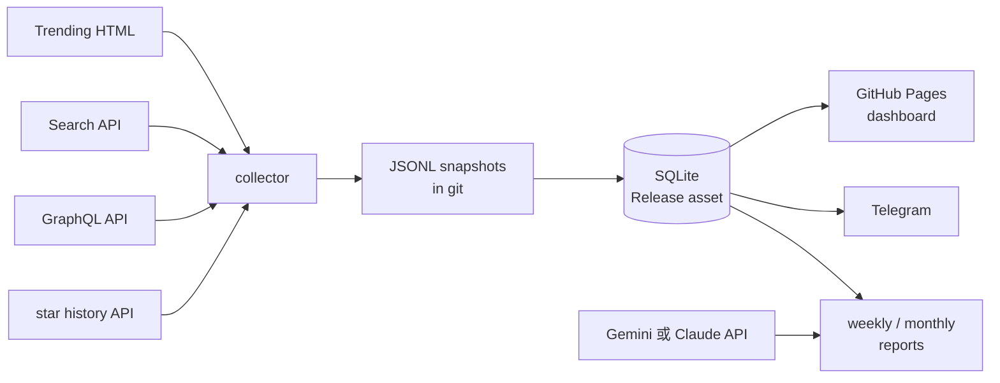
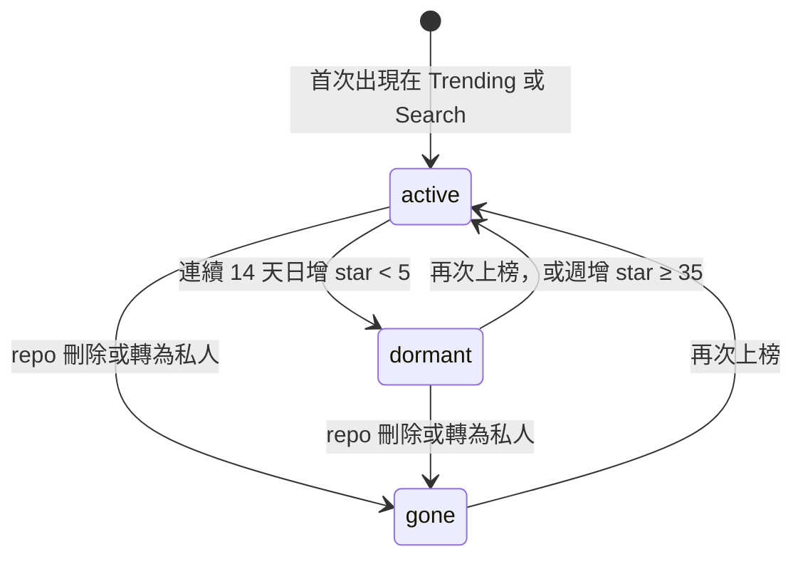

# starstrata 需求規格

starstrata 每日收集 GitHub 趨勢資料，長期保存成時間序列。
資料用來產出 dashboard、Telegram 通知與定期報告。

## 架構

- JSONL 快照是唯一的資料來源，SQLite 隨時能由快照重建。
- 所有工作由 GitHub Actions 排程執行，不需要自有主機。

## 資料來源

### Trending 頁面

- 範圍：總榜，加上語言清單 `python`、`typescript`、`javascript`、`java`、`go`、`rust`。
- 期間：`daily`、`weekly`、`monthly` 三種都抓。
- 一次執行共 21 個頁面。
- 記錄欄位：期間、語言、排名、repo 名稱、期間內新增 star 數。
- 官方沒有 API，必須解析 HTML。
- 不抓 Trending 的 developers 頁面。

### Search API

- 條件：近 30 天內建立，star ≥ 100。
- 依 star 數排序，取前 100 個。
- 記錄欄位：排名、repo 名稱。

### Repo 快照

- 用 GraphQL 批次查詢，一次 100 個 repo。
- 數值欄位每次都記：star、fork、watcher、open issue 數。
- 描述、topics、主要語言、archived 狀態，只在變動時記錄。
- repo 以 GraphQL `id`（node ID）識別，改名或轉移擁有者後仍是同一筆。

### 歷史回補

- 新加入追蹤的 repo，用 [star history API](https://docs.github.com/en/rest/activity/starring?apiVersion=2026-03-10#get-repository-star-history) 重建過去的 star 曲線。
- 這個 API 回傳每天新增的 star 數，只計入目前仍給 star 的使用者。
- 每個請求涵蓋 30 週，從最近一週往 repo 建立的那週回推。
- 每日回補請求有預算上限，用完時下次執行接續。
- 官方文件說明週與日的邊界不保證對齊 UTC。回補資料的日期以 UTC 換算，不保證等於實際給 star 的日期。

不採用 stargazers 清單 API。它自 2026 年 7 月起只開放給 repo 的 admin 與 collaborator（[changelog](https://github.blog/changelog/2026-06-30-upcoming-access-restrictions-to-public-api-endpoints-and-ui-views/)）。

## 追蹤池

repo 出現在 Trending 或 Search 結果時，加入追蹤池。

- `active`：每日記錄快照。
- `dormant`：每週記錄一次快照。
- `gone`：停止記錄，保留歷史資料。

## 爆紅判定

同時符合兩個條件時發出警示：

- 日增 star ≥ `N` × 近 7 日平均日增 star。
- 日增 star ≥ `M`。

規則：

- 近 7 日資料不足時，只看絕對下限 `M`。
- 同一個 repo 在冷卻期內只警示一次。
- `dormant` repo 沒有每日資料，不參與判定；再次上榜會轉回 `active`。

## 儲存

### JSONL 快照

- 路徑：`data/YYYY/MM/DD/{trending,search,repos}.jsonl`。
- 每次執行後 commit 進 repo。
- 回補資料存在 `data/backfill/`，每個 repo 一個檔案。
- 同一天重跑時覆寫當天的檔案。

### SQLite

- 由 JSONL 快照產生，上傳到固定 tag 的 Release asset。
- 每次執行時下載上一版 DB，寫入當天資料後再上傳。
- DB 毀損或 schema 變更時，從全部快照重建。

主要資料表：

| 資料表 | 內容 |
|---|---|
| `repos` | repo 基本資料、追蹤狀態、首次出現日期 |
| `repo_daily` | 每個 repo 每次快照的數值欄位 |
| `trending_entries` | 每日 Trending 上榜紀錄 |
| `search_hits` | 每日 Search 結果 |
| `star_backfill` | 回補得到的每日新增 star 數 |
| `alerts` | 爆紅警示紀錄 |

### 容量

- repo 快照的描述、topics 等欄位只在變動時記錄，以控制 git 增長速度。
- repo 超過 1 GB 時，把最早一年的快照封存成 Release asset，再從 git 移除。
- 封存尚未實作。目前從 `data/` 移除任何日期都會讓 `ingest` 重建 DB，該日期的資料就此消失；實作封存前，`ingest` 必須能讀取封存的快照。

## 輸出

### Dashboard

- 部署在 GitHub Pages。
- Python 從 SQLite 產生 JSON，前端用純 HTML/JS，不需要 npm 建置。
- 產生的 JSON 不 commit，由 Actions 直接部署。
- 頁面：今日榜單、爆紅列表、語言篩選、repo star 曲線。

### 說明翻譯

- repo 說明翻成繁體中文，dashboard、每日摘要與警示顯示譯文，並保留原文可查看。
- 翻譯沿用定期報告的模型供應商與模型名稱。
- 翻譯失敗時顯示原文，下次執行再補，不讓每日執行失敗。

### Telegram

- 每日摘要：今日 Trending 新增 star 前 10 名、追蹤中 repo 日增 star 前 10 名、新上榜與爆紅數量。靜音發送。
- 爆紅警示：每個符合條件的 repo 各發一則，有通知音。
- 執行失敗時發送失敗通知。

### 定期報告

- 週報：涵蓋週一到週日，下一週的第一次執行產生，路徑 `reports/weekly/YYYY-Www.md`。
- 月報：涵蓋整個月，下個月的第一次執行產生，路徑 `reports/monthly/YYYY-MM.md`。
- 排程漏跑時，之後的執行補產。
- 報告 commit 進 repo。
- 用 AI 模型為前 10 名專案產生中文解讀：專案在做什麼、為什麼受關注。
- 預設使用 Gemini API 的免費方案，可改用 Claude API。
- 模型 API 失敗時，照常產生報告，並在解讀段落標示缺漏。
- 模型名稱寫在設定檔。

## 排程與執行

- 每日一次，時間寫在 workflow 的 `cron`，以台灣時間 09:00 前完成為目標。
- 同時只允許一個執行，用 Actions `concurrency` 控制。
- 支援 `workflow_dispatch` 手動執行。
- 漏跑的日期不補抓 Trending，因為 Trending 無法查詢過去的資料。

公開 repo 連續 60 天沒有活動時，排程 workflow 會被 GitHub 停用。
每日的快照 commit 是否算活動，尚未確認，上線後需要驗證。

## 錯誤處理

- Trending 解析結果為 0 筆時視為失敗，不寫入空快照，並發送通知。
- API 達到額度上限時，保存已取得的資料，下次執行接續。
- 單一資料來源失敗不影響其他來源寫入。

## 設定與祕密

設定檔 `config.toml` 包含：

- Trending 語言清單與期間
- Search 條件
- 爆紅判定與降頻門檻
- 每日回補請求預算
- 執行日期的時區
- 中文解讀與說明翻譯的模型供應商與模型名稱
- 每次執行最多翻譯的說明則數

祕密存在 GitHub Actions secrets：

| 名稱 | 用途 |
|---|---|
| `GH_PAT` | 呼叫 GitHub API 收集資料，額度每小時 5,000 次 |
| `TELEGRAM_BOT_TOKEN` | Telegram Bot |
| `TELEGRAM_CHAT_ID` | 推播對象 |
| `GEMINI_API_KEY` | 說明翻譯與報告的中文解讀（預設供應商） |
| `ANTHROPIC_API_KEY` | 說明翻譯與報告的中文解讀（改用 Claude 時） |

內建的 `GITHUB_TOKEN` 只用於 commit、上傳 Release 與部署 Pages。
它的 API 額度是每個 repo 每小時 1,000 次，比 PAT 少，不用於收集資料。

## 參數預設值

以下數值是初始值，上線後依實際資料調整。

| 參數 | 預設值 |
|---|---|
| 爆紅倍數 `N` | 3 |
| 爆紅下限 `M` | 200 |
| 爆紅冷卻期 | 7 天 |
| 降為 `dormant` | 連續 14 天日增 star < 5 |
| 恢復 `active` | 再次上榜，或週增 star ≥ 35 |
| 每日回補請求預算 | 1,000 |
| 報告解讀數量 | 前 10 名 |

## 技術選型

| 項目 | 選擇 |
|---|---|
| 實作語言 | Python |
| 資料庫 | SQLite |
| 排程 | GitHub Actions |
| Dashboard 部署 | GitHub Pages |
| 推播 | Telegram Bot API |
| 中文解讀與說明翻譯 | Gemini API（預設）或 Claude API |

## 範圍外

- Trending 的 developers 頁面
- 使用者帳號與互動功能
- 小時級的資料精細度
